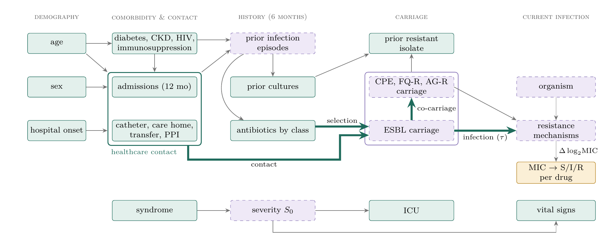
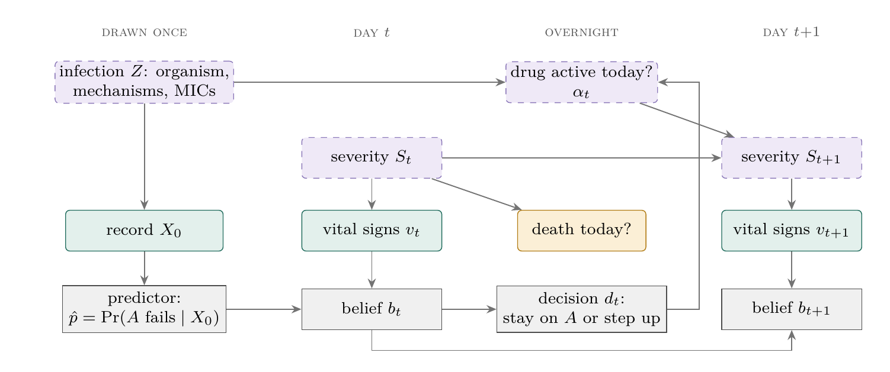
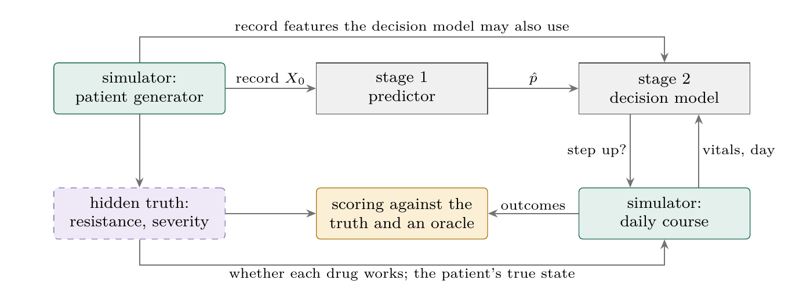

# ETTB: a synthetic patient simulator for empirical antibiotic therapy

ETTB (empirical-therapy test-bench) generates synthetic adults admitted with suspected urinary tract infection or gram-negative bloodstream infection. For each patient it knows what real records never show: the organism, its resistance mechanisms, whether each drug would work, and what would happen under each treatment choice. A resistance predictor or a treatment rule can be run on these patients and scored against that truth, including on the patients who were never cultured.

> **This is a research test-bench, not a clinical tool.** The patients are synthetic and the default parameters are placeholders. Nothing here is guidance on prescribing.

The first decision it supports is the one made before culture results arrive. Every patient starts drug *A*, and until the result is back a decision rule may switch once to a broader drug *B*. The simulator then follows the patient to day 30. The patient generator does not depend on this particular decision, so other treatment problems can be added on the same patients.

The simulator is written in JAX, so whole cohorts are generated and run in parallel on a laptop CPU.

## How a patient is generated

Each patient is generated in causal order.

1. **History.** Age and comorbidity drive healthcare contact. Past infections generate the record of prior antibiotics and prior cultures.
2. **Carriage.** Exposure and contact lead to carriage of resistance mechanisms (ESBL, carbapenemase, fluoroquinolone and aminoglycoside resistance, and OXA-1 co-carriage). Part of the exposure is never recorded.
3. **The infecting isolate.** The organism (*E. coli*, *K. pneumoniae* or *P. aeruginosa*), then an MIC for each of six drugs. EUCAST or CLSI breakpoints turn the MICs into S/I/R results.
4. **The course.** A hidden severity changes each day according to whether the current drug is active.



*How a patient is generated, left to right. Dashed lavender boxes are hidden, green boxes are in the record before culture, and amber is revealed by culture. The thick arrows are the resistance pathway that calibration fits.*

A separate observation step produces the record a clinician or model would see, with incomplete history, coding gaps and laboratory misclassification. Noise in the record never changes the underlying patient.

## What happens each day

The step-up task is a partially observed Markov decision process.

- Everyone starts drug *A*: ceftriaxone, or piperacillin–tazobactam if the infection began in hospital.
- Each day before the culture result, the rule may switch once to drug *B* (ertapenem, or meropenem when there is a *Pseudomonas* risk). A step-up cannot be undone before the result.
- The result arrives on day 2 or 3 by default, and the probabilities of day 1 to day 4 can be set. After the result, therapy is directed and the decisions end.



*One day of the decision process. The infection and the record are drawn once at admission. Each day the decision rule sees only the vital signs and its own belief that A is failing, which starts from the predictor's output. Grey boxes are the predictor and the decision rule, which sit outside the simulator.*

Within a day the order is as follows. The rule observes vital signs $v_t = S_t + \text{noise}$ and decides whether to step up. Today's drug counts as active, $\alpha_t = 1$, if the isolate tests S or I. Two optional switches handle exceptions: reduced piperacillin–tazobactam efficacy against OXA-1 co-producers that test susceptible, and amikacin counting only for urinary sources. The patient dies today with probability $\mathrm{logit}^{-1}(\theta_0 + \theta_1 S_t)$. Severity then moves as

$$S_{t+1} = S_t - \phi(S_t - s_0) + \kappa(1 - \alpha_t) - \lambda\alpha_t + \sigma\varepsilon_t,$$

so it rises while the drug fails and falls once it works. Patients without a bacterial infection recover whatever they receive.

All randomness is keyed by patient, day and stream, never by the action taken. The same patient can therefore be replayed under any rule, and the difference between two rules on the same cohort is an exact counterfactual.

## Inputs and outputs

| | |
|---|---|
| **Inputs** | |
| Site profile | Case mix (age, comorbidity, HIV, hospital onset), resistance levels, breakpoint standard, laboratory turnaround |
| Record quality | How much history the record holds, coding gaps, AST errors |
| Mechanism parameters | Effects of exposure and contact on carriage, MIC distributions, the severity and death model |
| Decision rule | Any function from what is observable each day to "step up or not" |
| **Outputs** | |
| The record | One row per patient: demographics, prior antibiotics and resistance, care setting, comorbidities, culture and S/I/R where cultured |
| The truth | Organism, mechanisms, MICs, whether *A* and *B* work, the severity path, for every patient whether cultured or not |
| Outcomes | Death by day 30, deterioration, days on an ineffective drug, days on *B*, under the rule used and under any alternative |

## How it plugs into a predictor and a decision model

The simulator wraps the two stages of a treatment pipeline without owning either of them.

1. A predictor turns the observed record into the probability that drug *A* will fail. It could be a published clinical ESBL score (for example the Augustine or Tumbarello scores), a logistic regression trained on simulated records with culture results as labels, or any machine-learning model.
2. A decision rule takes that probability, any record variables it wants and the daily vital signs, and decides each day whether to step up.
3. The simulator runs the course and returns the outcomes.



*The simulator (green) wraps a predictor and a decision model (grey), and their outcomes are scored against the hidden truth and an oracle.*

Because the truth is known, the two stages can be scored separately. The predictor is scored against true failure of *A* in every suspected infection, not only the cultured ones. The decision rule is scored against an oracle and against other rules on the same patients. How the outcomes are weighed against each other is left to the decision model.

## Repository layout

| Path | Contents |
|---|---|
| `ettb/world.py` | Generates patients (`sample_world`), produces their records (`observe`) and converts both to a pandas table (`to_frame`) |
| `ettb/env.py` | The daily step-up process, the built-in policies and `run_policy` |
| `ettb/loop.py` | `run_loop`, which runs the same process one day at a time so that any Python decision model can choose each morning |
| `ettb/params.py` | Default parameters, drug and organism lists, MIC and breakpoint tables |
| `params/ettb_v1_1d.json` | Calibrated parameters for a synthetic US-like site, with three outcome settings |
| `examples/` | The full loop: a predictor, decision models and scoring against the truth (see `examples/README.md`) |
| `figures/` | The diagrams used in this README |
| `tests/test_ettb.py` | Tests of exact replay, counterfactual invariances and the separation of truth from the record |
| `tests/test_loop.py` | Tests that `run_loop` reproduces `run_policy` exactly, of the example decision models and of the parameter file |

## Installation

The code was developed on Python 3.14 and needs at least 3.12. `requirements.lock.txt` pins the versions it was tested with.

```bash
python3 -m venv .venv
.venv/bin/pip install -r requirements.lock.txt
.venv/bin/python -I -m pytest -q
```

The package is not installed into the environment. Run your code from the repository root, or add the repository root to `PYTHONPATH`, and `import ettb`.

## A minimal example

The example samples a cohort, turns each record into a probability that drug *A* fails, runs two rules and compares them on the same patients. Run it from the repository root. It takes a few seconds on a laptop CPU.

```python
import numpy as np

from ettb import env as E
from ettb.params import default_params
from ettb.world import observe, sample_world

params = default_params()                                # illustrative defaults, not a calibrated site
world = sample_world(seed=0, n=50_000, params=params)    # the hidden truth for each patient
obs = observe(seed=0, world=world, params=params)        # what the patient's record shows

# A predictor maps the observed record to P(drug A will fail). This toy rule uses one
# variable: a previous ceftriaxone-resistant isolate on record.
prior_r = np.asarray(obs["prior_r_obs"])[:, 0]
p_fail = np.where(prior_r, 0.40, 0.08)

never = E.default_policy(E.FIXED, tau=99)                # stay on drug A
belief = E.default_policy(E.BELIEF, c=0.3)               # step up once P(A failing) > 0.3

# Same seed and world: the same patients with the same noise, so the comparison is counterfactual.
r0 = E.run_policy(13, world, never, obs=obs)
r1 = E.run_policy(13, world, belief, prior=p_fail, obs=obs)
d0, d1 = np.asarray(r0["died"]), np.asarray(r1["died"])
print(f"30-day mortality: never {d0.mean():.4f}, belief {d1.mean():.4f}")
print(f"stepped up {np.asarray(r1['stepped']).mean():.3f}; per 1000 patients: "
      f"{1000 * (d0 & ~d1).mean():.1f} deaths averted, {1000 * (~d0 & d1).mean():.1f} caused")
```

The built-in policies in `env.py` are a fixed day, a threshold on the predictor's output, a belief rule that combines the predictor with a filter on the vital signs, an oracle, and a rule meant to resemble historical practice. To test your own rule, write it as an object with `reset` and `act` methods and pass it to `ettb.loop.run_loop`, which gives the same outcomes as `run_policy` for the same seed and world. `examples/full_loop.py` does this end to end, from training a predictor to scoring decision rules against the truth. `run_policy` returns per-patient arrays (`died`, `death_day`, `stepped`, `step_day`, `inactive_days`, `b_days`, `severity_path` and others). Any parameter can be overridden by passing a modified copy of `default_params()` or, for the daily process, an `env_params` dictionary.

## Calibration

The default parameters are placeholders chosen to be plausible. They are not estimates for any hospital. Because every parameter is a plain float in a JAX pytree, the simulator can be calibrated by simulation-based inference. The approach we use has three parts.

- **Associations upstream of the decision.** Fit the carriage and contact effects so that a standard multivariable analysis of simulated patients reproduces published adjusted odds ratios for ESBL risk factors, together with ESBL prevalence. We use ABC-PMC with NumPyro priors, which gives a family of parameter sets rather than one best fit.
- **Microbiology.** Set the wild-type MIC distributions and breakpoints from EUCAST and CLSI tables. The `mic_tables_v11c` switch uses tables checked against EUCAST v16.1.
- **The links the decision acts on.** Fit the harm of an ineffective first drug to the observational odds ratio for inappropriate empirical therapy, and check the result against randomised trials and trial emulations run in silico on simulated patients.

Only the links the decision intervenes on need to be causally right: drug activity, the harm of an ineffective drug, the death hazard and laboratory turnaround. Everything upstream only has to reproduce observed associations. One calibrated parameter set (v1.1d, a synthetic US-like site) is in `params/ettb_v1_1d.json`, and `examples/full_loop.py` shows how to load it. The calibration code is not part of this repository yet.

## Extension routes

These are directions under consideration, not features.

- **A ward layer.** At present patients are independent, so the simulator cannot say what one patient's carbapenem course does to later patients. A ward layer would hold beds, carriage, transmission and selection, so that the same ward can be run under two prescribing policies with the same arrivals and the extra resistant carriage and infections among other patients counted.
- **South African transport.** Calibrate a site profile to South African surveillance and hospital cohorts, then test how predictors trained at a US-like site transport.
- **Open-dataset comparison.** Compare simulated records with large open patient-level datasets (ARMD, MIMIC-IV) wherever they record the same quantities.
- **ESBL predictability.** With a linear age effect, ceftriaxone resistance is more predictable in the simulator than in published hospital models. The `col_age_step` switch replaces the linear age term with a step at 70.

## Licence

The code is released under the MIT licence (`LICENSE`).
